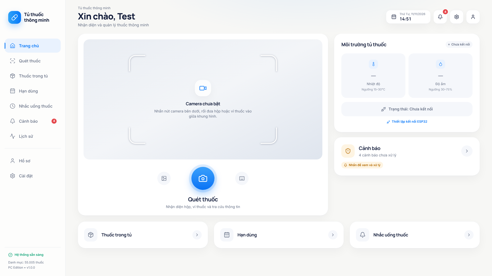

# Tủ thuốc thông minh (Smart Medicine Cabinet)

Ứng dụng desktop cho Windows 10/11 phục vụ đề tài nghiên cứu khoa học ngành Kỹ thuật máy tính:
quản lý thuốc trong tủ, **nhận diện thuốc bằng OCR** từ webcam/ảnh, đối chiếu với danh mục ~55.000 thuốc
(`DAV_unique.xlsx`), theo dõi **nhiệt độ / độ ẩm qua ESP32**, cảnh báo hạn dùng và nhắc uống thuốc.



> Ảnh chụp màn hình trong `docs/screenshots/` được chụp ở môi trường phát triển; các thuốc trong tủ ở ảnh là
> **dữ liệu mẫu minh hoạ**, không đi kèm ứng dụng.

| | |
|---|---|
| Giao diện | React 19 · TypeScript · Vite 8 · Tailwind CSS 4 · Lucide · Motion · Recharts |
| Desktop | Electron 45 · electron-builder 26 · NSIS |
| Backend | Python · FastAPI · Uvicorn · SQLite (FTS5) · SQLAlchemy 2 · Pydantic 2 |
| OCR & so khớp | PaddleOCR 3.7 (PP-OCRv6; engine PaddlePaddle chạy GPU NVIDIA nếu có, hoặc ONNX Runtime trên CPU) · OpenCV · RapidFuzz · pandas · openpyxl |

---

## 1. Trạng thái: đã kiểm chứng gì, chưa kiểm chứng gì

Ứng dụng được phát triển và kiểm thử trên **Linux** (máy ảo đám mây, không có Windows, không có webcam, không có
ESP32). Bảng dưới đây ghi rõ từng phần.

### Đã chạy và kiểm thử thật

| Hạng mục | Cách kiểm chứng |
|---|---|
| Backend (API, SQLite, nhập Excel, so khớp, cảnh báo, lời nhắc, sao lưu…) | 162 kiểm thử tự động `pytest` — xem [docs/TEST_REPORT.md](docs/TEST_REPORT.md) |
| Nhập toàn bộ `DAV_unique.xlsx` (55.005 dòng) vào SQLite + FTS5 | Kiểm thử trên file thật, ~25 giây; nhập lại không tạo bản ghi trùng |
| PaddleOCR 3.7.0 chạy thật (engine ONNX Runtime, không cần PaddlePaddle) | Bộ 11 ảnh **tổng hợp**: rõ, mờ, nghiêng, xoay ngược, tối, thiếu chữ, cùng tên khác hàm lượng |
| Giao diện 11 màn hình | 31 kiểm thử `vitest`, TypeScript + ESLint sạch, ảnh chụp ở 1920×1080 / 1600×1000 / 1366×768 |
| Electron: tự khởi động/dừng backend, cô lập renderer, token, chỉ nghe 127.0.0.1 | `npm run test:desktop` (9 bước, Electron thật + backend thật) |
| Luồng đầu-cuối: camera (giả lập bằng file ảnh) → chụp → OCR → 3 ứng viên → xác nhận → lưu tủ thuốc | Trong Electron, cả bản mã nguồn lẫn bản đóng gói |
| Đóng gói: PyInstaller (backend) + electron-builder (`--dir`) | Đã tạo và chạy **bản đóng gói cho Linux**; `npm run test:desktop:packed` đạt 9/9 với file Excel thật |
| `backend/requirements.txt` cài được trên Windows x64 | Đã giải phụ thuộc "chỉ dùng wheel" cho Python 3.11, 3.12, 3.13 (không cần trình biên dịch) |
| `scripts/*.ps1` | Kiểm tra cú pháp + chạy thử `setup-windows.ps1` bằng PowerShell 7 trên Linux |

### CHƯA kiểm chứng (cần bạn chạy trên máy Windows)

| Hạng mục | Ghi chú |
|---|---|
| **File cài đặt Windows `.exe` (NSIS)** | Không thể tạo trên Linux vì PyInstaller không biên dịch chéo. Đã có đủ script; xem mục 3. |
| Chạy trên Windows 10/11 thật | Mã không dùng API riêng của Linux, nhưng chưa có lần chạy nào trên Windows. |
| Webcam thật, ảnh chụp bao bì thật | Mới thử với camera giả lập và ảnh tổng hợp. **Không có số liệu độ chính xác OCR trên ảnh thật.** |
| ESP32 thật + firmware mẫu | Lớp kết nối chỉ được thử với trình mô phỏng; `firmware/esp32_cabinet/*.ino` chưa nạp lên mạch. |
| Thông báo Windows, khay hệ thống | Đã lập trình qua Electron `Notification`/`Tray`, chưa xem trên Windows. |
| Đọc tiếng Việt (TTS) | Phụ thuộc giọng tiếng Việt cài trong Windows; nếu thiếu, ứng dụng báo và hướng dẫn cài. |
| Đăng nhập Supabase | Chỉ thử với máy chủ giả lập trong kiểm thử; mặc định ứng dụng chạy hồ sơ cục bộ, **không có đăng nhập giả**. |
| Tải mô hình OCR chính thức (`scripts/download_ocr_models.py`) | Các máy chủ mô hình bị chặn ở môi trường phát triển. Mô hình đi kèm lấy từ PyPI — xem `ocr_models/SOURCE.txt`. |
| Engine PaddlePaddle trên máy khác | Đã chạy GPU trên Quadro P1000 (Windows 10, CUDA 11.8) cả bản mã nguồn lẫn bản đóng gói. Chưa thử card NVIDIA khác, và chưa thử bản cài trên máy không có GPU (khi đó ứng dụng tự chạy CPU, chậm — khoảng 12 giây/ảnh với mô hình medium). |

Giới hạn đã biết khác: tiếng Anh mới dịch phần giao diện chính; cột `tenDuongDung` (đường dùng) trong file Excel
để trống nên ứng dụng hiển thị "Chưa có dữ liệu"; bộ ký tự PP-OCRv6 thiếu phần lớn chữ Việt có dấu thanh nên văn
bản OCR thô có thể mất dấu (việc so khớp không phân biệt dấu nên không ảnh hưởng).

---

## 2. Chạy thử trên Windows (chế độ phát triển)

Cần: **Windows 10/11 64-bit**, **Python 3.11–3.13 (64-bit)**, **Node.js ≥ 20**.

```bat
setup-windows.bat      :: tạo backend\.venv, cài thư viện Python + Node, kiểm tra mô hình OCR và file Excel
run-dev.bat            :: mở ứng dụng (Electron + Vite + backend Python tự khởi động)
```

Hoặc chạy tay:

```powershell
python -m venv backend\.venv
backend\.venv\Scripts\python -m pip install -r backend\requirements-dev.txt
npm install            # cài thư mục gốc + frontend và tải sẵn bộ chạy Electron
npm run dev            # chế độ phát triển (hot reload)
npm start              # build giao diện rồi chạy như bản thật
```

Lần chạy đầu, ứng dụng tự nhập `data\DAV_unique.xlsx` vào SQLite (khoảng nửa phút, có thanh tiến trình). Những
lần sau không đọc lại file Excel.

## 3. Tạo bản cài đặt Windows

```bat
build-windows.bat
```

Script thực hiện: cài môi trường → chạy kiểm thử → build giao diện → đóng gói backend bằng PyInstaller →
kiểm tra đủ thành phần → electron-builder + NSIS. Kết quả:

```
release\SmartMedicineCabinet-Setup-1.0.0.exe     bản cài đặt
release\win-unpacked\SmartMedicineCabinet.exe    bản chạy thử không cần cài
```

Tham số: `build-windows.bat -SkipTests`, `-SkipSetup`, `-DirOnly` (chỉ tạo `win-unpacked`).
Sau khi build nên chạy `npm run test:desktop:packed` để kiểm tra bản đóng gói.

Lưu ý khi build:

- Lần đầu electron-builder tải NSIS và công cụ từ GitHub (cần Internet). Nếu báo lỗi
  *"A required privilege is not held by the client"*, hãy bật **Developer Mode** của Windows hoặc mở PowerShell
  bằng **Run as administrator**.
- Bản cài đặt **không có chữ ký số** nên SmartScreen sẽ cảnh báo ở lần chạy đầu (*More info → Run anyway*).
- **Engine PaddlePaddle + GPU:** nếu `backend\.venv` có cài `paddlepaddle-gpu` (lệnh cài trong
  `backend\requirements.txt`), bước đóng gói backend tự kèm PaddlePaddle, các DLL CUDA/cuDNN cần cho suy luận và
  mô hình PP-OCRv6 medium (định dạng Paddle). Bản cài khi đó mặc định dùng engine Paddle, chạy GPU NVIDIA nếu có,
  không có thì tự chạy CPU (*Cài đặt → Cấu hình OCR → Thiết bị chạy*). Muốn bản nhẹ chỉ có ONNX Runtime: đặt
  `SMC_BUNDLE_PADDLE=0` trước khi build.
- Kích thước đo trên Windows 10 (12/11/2026):

  | Bản | File cài `.exe` | Sau khi cài |
  |---|---|---|
  | Chỉ ONNX Runtime (CPU) | 0,27 GB | 0,7 GB |
  | Kèm PaddlePaddle GPU + mô hình medium | 1,44 GB | 3,5 GB |

  NSIS giới hạn file cài dưới 2 GB; để không vượt, chỉ các DLL CUDA dùng cho suy luận được chép
  (xem `NVIDIA_INFERENCE_DLLS` trong `backend\smc_backend.spec`).
- Trong bản cài đặt, người dùng **không cần cài Python** và không phải mở terminal: Electron tự khởi động
  `resources\backend\smc-backend.exe` và dừng nó khi thoát.

## 4. Dữ liệu nằm ở đâu

| Nội dung | Vị trí |
|---|---|
| CSDL SQLite (`cabinet.db`), ảnh thuốc, bản sao lưu, bộ nhớ đệm OCR | `%APPDATA%\SmartMedicineCabinet\data\` |
| Nhật ký backend | `%APPDATA%\SmartMedicineCabinet\logs\backend.log` |
| Chế độ phát triển | `%APPDATA%\SmartMedicineCabinet\data-dev\` (tách khỏi dữ liệu thật) |
| File Excel + mô hình OCR đi kèm (chỉ đọc) | `<thư mục cài đặt>\resources\data`, `resources\ocr_models` |

Không có dữ liệu nào được ghi vào thư mục cài đặt. Gỡ cài đặt **không xoá** dữ liệu người dùng.
Trong ứng dụng: *Cài đặt → Sao lưu và khôi phục → Mở thư mục dữ liệu*.

## 5. Kiến trúc

```
┌──────────────────────────── Electron (desktop/) ────────────────────────────┐
│  main.cjs      khởi động/dừng backend · cổng + token ngẫu nhiên · khay · thông báo │
│  preload.cjs   cầu nối hẹp window.smc (IPC cố định) — renderer KHÔNG có quyền Node  │
│  ┌──────────── Renderer: React + TypeScript (frontend/) ─────────────┐      │
│  │ AppShell (Sidebar + Topbar cố định) → 11 trang · React Query · Zustand │      │
│  └───────────────────────────┬───────────────────────────────────────┘      │
└──────────────────────────────┼──────────────────────────────────────────────┘
                 HTTP 127.0.0.1:<cổng ngẫu nhiên>  +  header X-SMC-Token
┌──────────────────────────────▼──────────────────────────────────────────────┐
│ FastAPI (backend/app)                                                        │
│  api/        health · medicines · catalog · ocr · cabinet · reminders · alerts ·     │
│              history · device · settings · profile · backup · notifications          │
│  services/   excel_import → medicine_matcher (chuẩn hoá, FTS5, RapidFuzz)            │
│              ocr (PaddleOCR + OpenCV, hàng đợi 1 luồng) · alerts · reminders ·       │
│              esp32 (HTTP polling / WebSocket) · backup · auth (Supabase, tuỳ chọn)   │
│  SQLite      danh mục 55k thuốc + FTS5 │ tủ thuốc │ lời nhắc │ cảnh báo │ lịch sử     │
└───────────────┬──────────────────────────────────────────┬──────────────────┘
        DAV_unique.xlsx (nhập 1 lần)                ESP32 trong mạng LAN
        ocr_models/ (PP-OCRv6 ONNX)                 GET /api/status  hoặc  WebSocket
```

Chi tiết: [docs/ARCHITECTURE.md](docs/ARCHITECTURE.md) · Giao thức ESP32: [docs/ESP32_PROTOCOL.md](docs/ESP32_PROTOCOL.md)

## 6. Nhận diện thuốc hoạt động thế nào

1. **Ảnh** từ webcam (chọn camera, lấy khung nét nhất trong 4 khung) hoặc file ảnh.
2. **OCR**: PaddleOCR đọc ảnh gốc; chỉ khi kết quả kém mới thử tăng tương phản, xoay 90°/180°/270°, nắn nghiêng,
   và chỉ giữ biến thể cho kết quả tốt hơn. Lưu văn bản thô, vị trí và độ tin cậy từng dòng.
3. **Trích xuất**: số đăng ký, hàm lượng, dạng bào chế, tên, hoạt chất (sửa lỗi OCR thường gặp như `l00 mg`, `VN-2O169-16`).
4. **Truy xuất ứng viên** trong SQLite: theo số đăng ký, FTS5 theo từ, trigram cho chữ sai/thiếu.
5. **Chấm điểm** bằng RapidFuzz, có giải thích từng thành phần: số đăng ký 35 %, tên 30 %, hàm lượng 20 %,
   hoạt chất 10 %, dạng bào chế 5 %. Hàm lượng mâu thuẫn bị giới hạn điểm — *Augmentin 250 mg/31,25 mg*,
   *500 mg/125 mg*, *875 mg/125 mg* là ba sản phẩm khác nhau.
6. **Hiển thị tối đa 3 ứng viên** với "Mức độ phù hợp" (Cao / Trung bình / Thấp), không phải phần trăm xác suất.

Nguyên tắc an toàn được lập trình và có kiểm thử:

- Không bao giờ tự lưu ứng viên đầu tiên; người dùng luôn phải bấm **Xác nhận và lưu**.
- Khi không đủ chắc chắn, hiện đúng câu *"Chưa thể xác định chắc chắn. Vui lòng chọn đúng thuốc."* và khoá nút
  xác nhận cho tới khi người dùng tự chọn; luôn có **Tìm thủ công** trong danh mục.
- **Hạn dùng thực tế** của hộp thuốc do người dùng nhập (hoặc OCR gợi ý rồi người dùng xác nhận). Ngày hết hạn
  **số đăng ký** trong Excel chỉ hiển thị để tham khảo, không bao giờ được dùng làm hạn dùng.
- Không sinh thông tin y khoa hay liều dùng: mọi trường hiển thị đều lấy từ Excel; lời nhắc do người dùng tự đặt.
- Chưa kết nối ESP32 thì hiện "Chưa kết nối" và dấu "–", không có số đo giả.

## 7. ESP32

- *Cài đặt → Kết nối thiết bị*: bật **Bật kết nối ESP32**, nhập địa chỉ IP, cổng, giao thức (HTTP polling / WebSocket),
  bấm **Thử kết nối**, rồi **Lưu cài đặt**.
- Giao thức JSON: [docs/ESP32_PROTOCOL.md](docs/ESP32_PROTOCOL.md). Firmware mẫu (DHT22 + còi):
  `firmware/esp32_cabinet/esp32_cabinet.ino` — **chưa thử trên phần cứng**.
- Thử không cần phần cứng: `python scripts\esp32_simulator.py --port 8080` rồi nhập địa chỉ `127.0.0.1`, cổng `8080`.
  Trình mô phỏng gửi `"simulated": true` nên giao diện luôn gắn nhãn **Mô phỏng**.

## 8. Kiểm thử

```powershell
npm test                    # pytest (backend) + vitest (giao diện)
npm run lint                # ESLint + kiểm tra kiểu TypeScript
npm run test:desktop        # Electron thật + backend thật (cần đã build giao diện: npm run build:frontend)
npm run test:desktop:packed # kiểm tra bản đóng gói trong release\ (sau npm run pack hoặc build-windows)
```

Kết quả gần nhất và bảng đối chiếu 15 mục kiểm thử bắt buộc: [docs/TEST_REPORT.md](docs/TEST_REPORT.md).
Dữ liệu kiểm thử (`tests/fixtures/`) là tập con của file Excel thật và ảnh tổng hợp; ứng dụng không bao giờ nạp
chúng làm dữ liệu thật.

## 9. Bảo mật

- Backend chỉ nghe trên `127.0.0.1` (kể cả khi `SMC_HOST` bị đặt nhầm), cổng ngẫu nhiên mỗi lần chạy.
- Mọi yêu cầu API phải có token ngẫu nhiên do Electron sinh ra mỗi phiên; kiểm tra `Host` chống DNS rebinding.
- Renderer: `contextIsolation: true`, `nodeIntegration: false`, `sandbox: true`, CSP `script-src 'self'`;
  chặn mở cửa sổ mới và điều hướng ra ngoài; IPC chỉ nhận từ trang của ứng dụng.
- Không có khoá API hay mật khẩu trong mã nguồn. Supabase (tuỳ chọn) cấu hình bằng biến môi trường
  `SUPABASE_URL`, `SUPABASE_ANON_KEY` — xem `.env.example`.
- Không có đường dẫn tuyệt đối của máy lập trình viên trong mã nguồn.

## 10. Cấu trúc thư mục

```
desktop/            Electron: main.cjs (tiến trình chính), preload.cjs (cầu nối an toàn)
frontend/src/       components/ layouts/ pages/ hooks/ services/ stores/ styles/ types/ i18n/ test/
backend/app/        api/ core/ database/ models/ schemas/ services/{ocr,medicine_matcher,excel_import,alerts,reminders,esp32}
backend/            requirements.txt · requirements-dev.txt · smc_backend.spec (PyInstaller) · run_backend.py
data/               DAV_unique.xlsx (danh mục thuốc gốc)
ocr_models/         PP-OCRv6 small (ONNX) + SOURCE.txt
scripts/            setup-windows.ps1 · build-windows.ps1 · build-backend.mjs · check-resources.mjs ·
                    download_ocr_models.py · build_ocr_models_from_rapidocr.py · esp32_simulator.py · make_*.py
tests/              backend/ (pytest) · desktop/smoke.mjs · fixtures/ (dữ liệu kiểm thử)
firmware/           esp32_cabinet/esp32_cabinet.ino (mẫu)
docs/               ARCHITECTURE.md · ESP32_PROTOCOL.md · TEST_REPORT.md · screenshots/
assets/             icon.png · icon.ico
```

## 11. Sự cố thường gặp

| Hiện tượng | Cách xử lý |
|---|---|
| Màn hình "Không khởi động được dịch vụ nền" | Bấm **Mở thư mục nhật ký**, xem `backend.log`. Ở chế độ dev: kiểm tra đã chạy `setup-windows.bat`. |
| "OCR chưa sẵn sàng" | Thiếu mô hình trong `ocr_models\`. Chạy `npm run models`, hoặc `backend\.venv\Scripts\python scripts\build_ocr_models_from_rapidocr.py --out ocr_models`. |
| "Chưa có danh mục thuốc" | *Cài đặt → Dữ liệu thuốc → Chọn file Excel…* và chọn `DAV_unique.xlsx`; ứng dụng nhập ngay sau khi chọn. |
| Không thấy camera | Windows *Settings → Privacy & security → Camera*: cho phép ứng dụng desktop dùng camera; chọn lại camera trong *Cài đặt*. |
| Không đọc được tiếng Việt | Windows *Settings → Time & language → Speech → Add voices → Vietnamese*, rồi khởi động lại ứng dụng. |
| ESP32 "Mất kết nối" | Máy tính và ESP32 phải cùng mạng LAN; thử mở `http://<ip-esp32>/api/status` bằng trình duyệt. |
| `pip install` lỗi trên Python 3.14+ / 32-bit | Dùng Python 3.11–3.13 bản 64-bit. |

## 12. Lưu ý sử dụng

Đây là phần mềm phục vụ nghiên cứu, **không phải thiết bị y tế**. Thông tin thuốc lấy nguyên văn từ file danh mục;
kết quả OCR chỉ là gợi ý và luôn cần người dùng đối chiếu với bao bì thật. Hỏi dược sĩ hoặc bác sĩ trước khi dùng thuốc.
